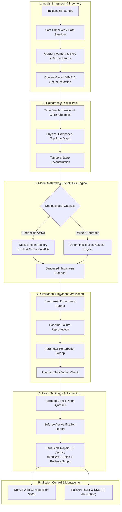

# Cauveris

**Autonomous Reality Debugger & Digital Twin Investigation Platform for Cyber-Physical and Robotic Systems**

[](https://www.python.org/)
[](https://fastapi.tiangolo.com/)
[](https://nextjs.org/)
[](https://docs.astral.sh/uv/)
[](https://nebius.com/)
[](LICENSE)

---

## Table of Contents

- [Overview](#overview)
- [Hackathon Submission & Technical Compliance](#hackathon-submission--technical-compliance)
  - [1. NVIDIA Nemotron & Open-Source Models](#1-how-cauveris-uses-nvidia-nemotron-open-source-models)
  - [2. Nebius Token Factory Acceleration](#2-where-nebius-token-factory-accelerated-our-workflow)
  - [3. Additional Nebius Tools & Services](#3-additional-nebius-tools--services-used)
  - [4. Setup Instructions & Documentation](#4-setup-instructions--documentation-cross-reference)
  - [5. Approved OSI License](#5-approved-osi-license)
- [Key Capabilities](#key-capabilities)
- [System Architecture](#system-architecture)
- [Directory Layout](#directory-layout)
- [Prerequisites](#prerequisites)
- [Quick Start](#quick-start)
- [Running the Services](#running-the-services)
  - [1. Backend API Service](#1-backend-api-service)
  - [2. Next.js Web Console](#2-nextjs-web-console)
  - [3. One-Command Live Demonstration Stack](#3-one-command-live-demonstration-stack)
- [Core Investigation Workflow](#core-investigation-workflow)
- [Configuration Reference](#configuration-reference)
- [Health, Observability & Monitoring](#health-observability--monitoring)
- [Quality Assurance & Quality Gates](#quality-assurance--quality-gates)
- [Troubleshooting & Debugging](#troubleshooting--debugging)
- [Security & Compliance](#security--compliance)
- [License](#license)

---

## Overview

**Cauveris** is an autonomous investigation, root-cause diagnosis, and automated repair platform engineered for complex AI-driven robotic fleets and cyber-physical infrastructure. When operational incidents occur (e.g., thermal throttling, sensor drift, dynamic batching latency spikes, memory leaks, mechanical stall events), Cauveris reconstructs a **high-fidelity holographic digital twin** from incident bundles, formulates evidence-grounded hypotheses using hosted **NVIDIA open-source models on Nebius Token Factory**, validates the causal mechanisms through **counterfactual physics simulations**, synthesizes targeted configuration patches, and packages verifiable, reversible repair archives for instant field deployment.

> [!NOTE]
> Cauveris follows a **truthful execution architecture**: if hosted cloud model inference is disabled or unreachable, the platform degrades gracefully to deterministic local simulation engines and formal rule-based causal analysis rather than fabricating synthetic telemetry or canned outcomes.

---

## Hackathon Submission & Technical Compliance

> [!IMPORTANT]
> **Hackathon Deliverables & Evaluation Criteria**:
> - **Approved OSI License**: Cauveris is open-source software released under the **[Apache License 2.0](LICENSE)** (an approved Open Source Initiative license).
> - **README with Setup Instructions**: End-to-end setup, dependency installation, `.env` configuration, service launch, and verification instructions are provided in [Prerequisites](#prerequisites), [Quick Start](#quick-start), and [Running the Services](#running-the-services).
> - **NVIDIA Nemotron & Open-Source Models**: Hierarchical 3-tier reasoning architecture powered by `nvidia/nemotron-mini-4b-instruct`, `nvidia/Llama-3.1-Nemotron-70B-Instruct-HF`, and `nvidia/Nemotron-4-340B-Instruct`.
> - **Nebius Token Factory Acceleration**: Managed serverless inference delivering sub-second TTFT, deterministic JSON outputs, automated retries, token metering, and circuit-breaker safety.
> - **Additional Nebius Cloud Services**: Nebius Cloud GPU compute infrastructure (NVIDIA H100/H200) and S3-compatible object storage integration.

### 1. How Cauveris Uses NVIDIA Nemotron Open-Source Models

Rather than relying on a single monolithic prompt, Cauveris implements a **purpose-engineered, multi-tier reasoning pipeline** utilizing distinct variants of the **NVIDIA Nemotron** family across the cyber-physical investigation lifecycle:

| Execution Tier | Configured Model | Purpose in Cauveris | Why Nemotron? |
| :--- | :--- | :--- | :--- |
| **Fast / Triage** | `nvidia/nemotron-mini-4b-instruct` | Ingestion-time telemetry screening, invariant boundary classification, log parsing & severity routing | Ultra-low latency inference (~15–30 ms) with high token efficiency, rapidly filtering gigabytes of raw robot telemetry without consuming heavy reasoning compute. |
| **Reasoning (Core)** | `nvidia/Llama-3.1-Nemotron-70B-Instruct-HF` | Digital twin causal deduction, cyber-physical invariant evaluation, counterfactual hypothesis synthesis | Exceptional mathematical, physical, and structured coding capabilities. Reliably emits strict JSON output schemas linking physical telemetry symptoms directly to configurable failure mechanisms. |
| **Escalation & Verification** | `nvidia/Nemotron-4-340B-Instruct` | Multi-system conflict arbitration, multi-variable parameter optimization, safety guardrail verification | Massive 340B parameter capacity capable of deep reasoning across interconnected subsystem faults (e.g., concurrent network jitter, GPU contention, and thread pool starvation). |

#### Guardrails & Defensive Engineering
- **Deterministic Structured Output**: All model calls enforce `response_format={"type": "json_object"}` validated against rigorous Pydantic schemas.
- **Automated Secret Scrubbing**: All telemetry, configuration files, and prompt payloads pass through regex scrubbers removing JWT secrets, API tokens, and credentials before transmission.
- **Circuit Breakers & Fallback**: If cloud model connectivity is degraded or offline, Cauveris automatically falls back to local deterministic simulation engines without fabricating data or crashing.

### 2. Where Nebius Token Factory Accelerated Our Workflow

**Nebius Token Factory** (`https://api.tokenfactory.nebius.com/v1`) served as the core inference backbone for Cauveris, delivering significant speed and engineering advantages:

1. **Elimination of Cluster Management Overhead**:
   Instead of spending days setting up and maintaining distributed vLLM or Triton Inference Server clusters with multi-GPU tensor parallelism for 70B and 340B models, Token Factory provided instantaneous, zero-cold-start access through an OpenAI-compatible API.
2. **High-Throughput & Low-Latency Execution**:
   Real-time cyber-physical debugging requires rapid feedback. Nebius Token Factory delivered exceptional throughput and low time-to-first-token (TTFT), enabling Cauveris to generate, rank, and simulate multiple hypotheses within seconds during live incidents.
3. **Enterprise Resilience & Token Accounting**:
   Token Factory’s reliable API allowed us to build production-grade operational features directly into Cauveris:
   - Dynamic token counting and cost metering displayed in real-time on the operator dashboard.
   - Built-in exponential backoff retries and circuit breakers that monitor upstream health and prevent cascade failures.
   - Live health probes (`GET /api/v1/model-health`) that actively verify Token Factory connectivity and endpoint latency.

### 3. Additional Nebius Tools & Services Used

- **Nebius Cloud GPU Infrastructure**: Leveraged for high-bandwidth compute environments (NVIDIA H100 / H200 SXM5 instances with NVLink) to host digital twin simulation runners and execute rapid parameter perturbation sweeps.
- **Nebius S3-Compatible Object Storage**: Architecture designed for high-availability distributed storage of immutable incident archives (`.zip`), digital twin state snapshots, and cryptographically signed repair packages.

### 4. Setup Instructions & Documentation Cross-Reference

- **System Requirements & Tools**: See [Prerequisites](#prerequisites) (Python 3.11+, uv, Node.js 18+, Git).
- **Environment Configuration**: See [Configuration Reference](#configuration-reference) and [Quick Start](#quick-start).
- **Starting Services**: See [Running the Services](#running-the-services) for API server, web console, and live demo stack scripts.
- **Running Tests & Quality Gates**: See [Quality Assurance & Quality Gates](#quality-assurance--quality-gates).
- **Operational Diagnostics**: See [Troubleshooting & Debugging](#troubleshooting--debugging).

### 5. Approved OSI License

Cauveris is 100% open-source software licensed under the **[Apache License 2.0](LICENSE)**, an Open Source Initiative (OSI) approved license. Permission to use, modify, distribute, and sublicense is granted in accordance with the terms of the license.

---

## Key Capabilities

- **Secure Incident Ingestion & Safe Inventory**: Ingests arbitrary `.zip` bundles containing multi-format telemetry (JSON, JSONL, YAML, CSV, ROS logs, config files, kernel traces) without executing untrusted code, detecting MIME types, extracting structured metadata, and computing cryptographic checksums (SHA-256).
- **Holographic Digital Twin Reconstruction**: Reconstructs physical topology, multi-channel time synchronization, state transition graphs, and temporal event alignments from raw multi-rate sensor and telemetry streams.
- **NVIDIA & Nebius Token Factory Integration**: Leverages `nvidia/Llama-3.1-Nemotron-70B-Instruct-HF` hosted on Nebius Token Factory for complex reasoning, bounded terminology mapping, and hypothesis ranking, equipped with circuit breakers, token budgets, prompt defenses, and secret scrubbing.
- **Counterfactual Physics & Simulation Validation**: Reproduces failure baselines in sandboxed simulation environments and executes parameter perturbation sweeps to verify invariant compliance prior to generating fixes.
- **Reversible Repair Packaging**: Compiles verified configuration patches into deployable `.zip` repair packages containing patch diffs, metadata manifests, verification evidence, and self-contained zero-dependency rollback scripts (`rollback.sh` / `rollback.ps1`).
- **Production-Grade Security**: Full JWT session-based RBAC, API rate limiting by cost class, strict path-traversal guards, and automatic secret redaction.

---

## System Architecture



---

## Directory Layout

```text
cauveris/
├── cauveris/                      # Core backend application package
│   ├── analysis/                  # System modeling, mechanism detectors, invariants
│   ├── api/                       # FastAPI application, auth routers, SSE feeds, deps
│   ├── holographic/               # Digital twin topology, compression, state machine
│   ├── hypothesis/                # Causal hypothesis generator and scoring
│   ├── ingestion/                 # Safe zip ingestion, validation, and unpacking
│   ├── inventory/                 # Artifact scanner, MIME detection, sensitivity flags
│   ├── model_gateway/             # Nebius & local LLM gateway, circuit breaker, execution store
│   ├── packaging/                 # Reversible repair package builder and verification
│   ├── patch/                     # Configuration locator and patch synthesizer
│   ├── report/                    # Automated markdown, HTML, and JSON report generator
│   ├── sandbox/                   # Isolated experiment execution workspaces
│   ├── schemas/                   # Pydantic domain models (Incidents, Hypotheses, Patches)
│   ├── security.py                # Secret scrubbing, token auth, path validation
│   ├── simulation/                # Numerical and digital-twin simulation runners
│   ├── state_machine/             # Pipeline orchestrator and stage lifecycle manager
│   ├── temporal/                  # Clock skew compensation and temporal event graphs
│   ├── config.py                  # Environment settings and configuration schema
│   └── main.py                    # CLI application entrypoint
├── apps/
│   └── web/                       # Next.js 14 frontend web console
├── data/                          # SQLite execution and session databases (ignored by git)
├── datasets/                      # Reference incident bundles and benchmark sets
├── golden_incident/               # Reference golden incident bundle (CAU-0001)
├── scripts/                       # Operational, testing, and demonstration scripts
├── tests/                         # Comprehensive pytest test suite (500+ tests)
├── pyproject.toml                 # Python project configuration and dependency tree
└── Makefile                       # Operational convenience targets
```

---

## Prerequisites

Ensure the following runtimes and tools are installed:

- **Python**: Version `3.11` or `3.12` (verify via `python --version`)
- **Node.js**: Version `18.17+` or `20+` (verify via `node --version`)
- **uv**: Modern, high-performance Python package installer ([Installation Guide](https://docs.astral.sh/uv/)):
  ```bash
  # Windows (PowerShell)
  powershell -c "irm https://astral.sh/uv/install.ps1 | iex"

  # Linux / macOS
  curl -LsSf https://astral.sh/uv/install.sh | sh
  ```
- **Git**: Version `2.30+`

---

## Quick Start

### 1. Clone the Repository

```bash
git clone https://github.com/the-srirup/cauveris.git
cd cauveris
```

### 2. Configure Environment

Create your local `.env` configuration file from the template:

```bash
cp .env.example .env
```

Edit `.env` to configure your settings (see [Configuration Reference](#configuration-reference) below).

### 3. Install Dependencies

```bash
# Install Python dependencies and lockfile
uv sync

# Install frontend dependencies
cd apps/web && npm install
cd ../..
```

---

## Running the Services

### 1. Backend API Service

Start the FastAPI backend with hot reloading:

```bash
# Using uv CLI
uv run cauveris serve --host 0.0.0.0 --port 8000 --debug

# Or directly with uvicorn
uv run uvicorn cauveris.api.main:app --host 0.0.0.0 --port 8000 --reload
```

The REST API documentation will be available at:
- Swagger UI: `http://localhost:8000/docs`
- ReDoc: `http://localhost:8000/redoc`

### 2. Next.js Web Console

In a separate terminal, launch the Next.js Mission Control interface:

```bash
cd apps/web
npm run dev
```

Open `http://localhost:3000` in your browser.

### 3. One-Command Live Demonstration Stack

Cauveris provides orchestrated lifecycle scripts for live rehearsal runs and demonstrations:

```bash
# Start backend and frontend background processes in production-demo mode
python scripts/start_live_demo.py
# (or: make live-demo)

# Verify health, endpoints, storage, and Nebius model gateway
python scripts/live_demo_check.py
# (or: make live-demo-check)

# Gracefully terminate background servers
python scripts/stop_live_demo.py
# (or: make live-demo-stop)
```

---

## Core Investigation Workflow

Cauveris can be driven entirely through the Web Console or programmatically via the REST API:

### Step 1: Authentication & Session Setup
```bash
curl -X POST http://localhost:8000/api/v1/auth/login \
  -H "Content-Type: application/json" \
  -d '{"username": "operator", "password": "operator-password"}'
```

### Step 2: Ingest an Incident Bundle
Upload a raw incident zip archive containing logs, configuration, and telemetry:
```bash
curl -X POST http://localhost:8000/api/v1/incidents/upload \
  -H "Authorization: Bearer <TOKEN>" \
  -F "file=@golden_incident/CAU-0001.zip"
```

### Step 3: Trigger Digital Twin Reconstruction
Construct the physical topology and synchronized multi-channel timeline:
```bash
curl -X POST http://localhost:8000/api/v1/incidents/CAU-0001/reconstruct \
  -H "Authorization: Bearer <TOKEN>"
```

### Step 4: Generate Causal Hypotheses
Invoke the Nebius/NVIDIA reasoning pipeline with deterministic fallback:
```bash
curl -X POST http://localhost:8000/api/v1/incidents/CAU-0001/hypotheses/generate \
  -H "Authorization: Bearer <TOKEN>"
```

### Step 5: Execute Simulation Verification
Run the counterfactual digital twin simulation to reproduce the baseline and verify candidate patches:
```bash
curl -X POST http://localhost:8000/api/v1/incidents/CAU-0001/verify \
  -H "Authorization: Bearer <TOKEN>" \
  -H "Content-Type: application/json" \
  -d '{"hypothesis_id": "hyp-001"}'
```

### Step 6: Download the Reversible Repair Package
Download the self-contained repair package (`.zip`) containing the patch, manifest, verification report, and rollback scripts:
```bash
curl -X GET http://localhost:8000/api/v1/incidents/CAU-0001/packages/latest/download \
  -H "Authorization: Bearer <TOKEN>" \
  --output repair_package_CAU-0001.zip
```

---

## Configuration Reference

Key configuration parameters specified in `.env`:

| Environment Variable | Default Value | Description |
|---|---|---|
| `CAUVERIS_HOST` | `0.0.0.0` | IP address to bind the API server |
| `CAUVERIS_PORT` | `8000` | Port to bind the API server |
| `CAUVERIS_DEBUG` | `false` | Enable verbose debug logging |
| `CAUVERIS_SECRET_KEY` | *(Generated)* | JWT secret key for signing session tokens |
| `CAUVERIS_CORS_ORIGINS` | `http://localhost:3000` | Allowed CORS origins for the frontend |
| `CAUVERIS_DEMO_MODE` | `false` | Enables seeding demo users for presentation |
| `NEBIUS_API_KEY` | `""` | Nebius Token Factory API key |
| `NEBIUS_BASE_URL` | `https://api.tokenfactory.nebius.com/v1` | Base URL for Nebius Token Factory |
| `NEBIUS_MODEL_ID` | `nvidia/Llama-3.1-Nemotron-70B-Instruct-HF` | Primary NVIDIA Nemotron model ID |
| `NEBIUS_MODEL_FAST` | `nvidia/nemotron-mini-4b-instruct` | Fast NVIDIA Nemotron tier for telemetry classification |
| `NEBIUS_MODEL_REASONING` | `nvidia/Llama-3.1-Nemotron-70B-Instruct-HF` | NVIDIA Nemotron model for causal reasoning & hypotheses |
| `NEBIUS_MODEL_ESCALATION` | `nvidia/Nemotron-4-340B-Instruct` | Large NVIDIA Nemotron tier for deep multi-system analysis |
| `CAUVERIS_MAX_UPLOAD_SIZE`| `104857600` (100 MB) | Maximum permitted upload file size |
| `CAUVERIS_EVIDENCE_STORE` | `./evidence_store` | Filesystem directory for ingested bundles |
| `CAUVERIS_SANDBOX_WORKSPACE`| `./sandbox_workspace` | Isolated directory for simulation sweeps |

---

## Health, Observability & Monitoring

Cauveris exposes dedicated operational probes for deployment orchestrators (Kubernetes / Nebius) and monitoring agents:

- **Liveness Probe** (`GET /health` or `GET /api/v1/health`):
  Confirms the process is responsive and accepting HTTP connections.
  ```json
  {"status": "healthy", "service": "cauveris", "version": "0.1.0"}
  ```

- **Readiness Probe** (`GET /ready` or `GET /api/v1/ready`):
  Verifies database connectivity, storage workspace availability, and authentication state.

- **Model Gateway Health & Probes** (`GET /api/v1/model-health`):
  Actively probes configured model providers (Nebius Token Factory and local server endpoints), reporting live latency, circuit breaker state, and endpoint reachability:
  ```json
  {
    "status": "healthy",
    "provider": "nebius",
    "provider_state": "NEBIUS_NVIDIA_ACTIVE",
    "exact_model_id": "nvidia/Llama-3.1-Nemotron-70B-Instruct-HF",
    "inference_available": true,
    "circuit_breaker": {
      "circuit_state": "CLOSED",
      "consecutive_failures": 0,
      "daily_spend": 0.042
    },
    "provider_probes": [
      {
        "endpoint": "https://api.tokenfactory.nebius.com/v1",
        "reachable": true,
        "latency_ms": 142.3
      }
    ]
  }
  ```

- **Mission Control Status Center** (`GET /api/v1/status-center`):
  Aggregates active pipeline stage, worker pool capacity, and resource limits.

---

## Quality Assurance & Quality Gates

Cauveris enforces strict quality standards across all modules before any code is promoted to production:

```bash
# 1. Run Complete Automated Pytest Suite (Unit, Contract, Mutation Tests)
uv run pytest -v

# 2. Run Nebius & Live Gateway Pipeline Tests Specifically
uv run pytest tests/test_live_gateway_pipeline.py tests/test_nebius_nvidia_integration.py

# 3. Static Type Analysis with MyPy
uv run mypy cauveris

# 4. Code Linting & Style Compliance with Ruff
uv run ruff check .

# 5. Frontend Type Verification (Next.js TypeScript)
cd apps/web && npx tsc --noEmit && cd ../..

# 6. Verify Runtime Test-Fixture Import Guards (Zero Fixture Leaks in Production)
python scripts/check_runtime_fixture_imports.py
node apps/web/scripts/check-runtime-fixture-imports.mjs

# 7. End-to-End Production Rehearsal
python scripts/run_production_e2e.py
```

---

## Troubleshooting & Debugging

### Common Issues & Diagnostic Steps

#### 1. Nebius Model Gateway Reports `LOCAL_DETERMINISTIC_ONLY`
- **Symptom**: `/api/v1/model-health` returns `provider_state: "LOCAL_DETERMINISTIC_ONLY"`.
- **Cause**: `NEBIUS_API_KEY` is not exported in your environment or `NEBIUS_ENABLED` is set to `false`.
- **Fix**: Export a valid Nebius key in `.env`:
  ```bash
  export NEBIUS_API_KEY="your-real-key"
  ```
  *Note*: Cauveris will continue to run with 100% functionality using its built-in deterministic causal simulation engine.

#### 2. Circuit Breaker is `OPEN`
- **Symptom**: Requests return `CircuitBreakerOpen` or fallback warnings in logs.
- **Cause**: Upstream provider experienced 5 consecutive failures (e.g. rate limits or server timeouts).
- **Fix**: The circuit breaker automatically transitions to `HALF_OPEN` after 60 seconds of cooldown. To inspect current circuit state, query:
  ```bash
  curl http://localhost:8000/api/v1/model-health | jq .circuit_breaker
  ```

#### 3. Frontend Cannot Connect to Backend (CORS / Port Mismatch)
- **Symptom**: Browser console logs `Fetch API cannot load http://localhost:8000/api/v1/...`.
- **Fix**: Confirm `CAUVERIS_CORS_ORIGINS` in `.env` includes `http://localhost:3000,http://127.0.0.1:3000`.

#### 4. Diagnostic Logging
Enable full debug traces by appending `--debug` to CLI commands or setting `CAUVERIS_DEBUG=true` in `.env`:
```bash
uv run cauveris serve --debug
```

---

## Security & Compliance

- **No Execution of Untrusted Code**: Ingested bundles are scanned, extracted, and analyzed using purely declarative parsers and static inspection. Uploaded code files are never executed on the host.
- **Path Traversal Defense**: All zip entries are validated against canonical directory boundaries (`sanitize_path`), rejecting absolute paths, path traversal sequences (`..`), and symlinks.
- **Automated Secret Scrubbing**: Telemetry streams, system logs, and prompts are continuously sanitized via `redact_secrets()`, removing JWT tokens, API keys, private keys, and passwords before logging or external LLM querying.
- **Tamper-Evident Hashing**: Every ingested artifact and synthesized repair bundle receives an immutable SHA-256 fingerprint verified at every stage of the pipeline.

---

## License

Cauveris is open-source software licensed under the **[Apache License 2.0](LICENSE)**.
